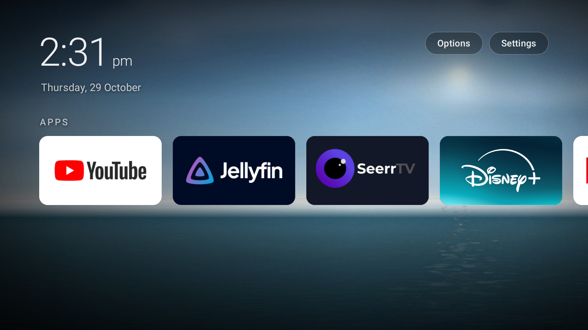

# dumbtv home — fork

**Short description for GitHub (About):**

> A fork of dumbtv home: a quieter, cinematic Fire TV launcher with four bundled
> ambient scenes and a working HOME takeover on Fire OS 8. Still offline, ad-free,
> and permission-free on Fire OS 7/8. Apps and HDMI inputs only.

This is a fork of [humblemuzzu/dumbtv](https://github.com/humblemuzzu/dumbtv),
focused on the home screen. This copy lives at
[Kyneton95/dumbtv](https://github.com/Kyneton95/dumbtv). It keeps the upstream purpose — a fast, offline
launcher for apps and HDMI inputs with no ads, tracking, accounts or network
permission — and changes how it looks and how reliably it takes HOME on newer
Fire OS.

## What is different

- **Upstream synced.** The launcher now carries upstream's grid layout, built-in
  HDMI input screen, adaptive backgrounds, cover-based Fire OS 8 HOME fix, Afterglow
  tile style, brand colors, memory meter, and recent-apps tracking — the full
  upstream main as of this sync, not just the 1.2 release.
- **A new look.** Full-bleed ambient scenes, a layered scrim, a 64 sp light clock,
  larger 16:9 cards, a softer multi-cue focus state, and a redesigned Options
  screen.
- **Four built-in scenes.** Daylight, Aurora, Dunes at dusk and Moonlit
  coast are packed into the APK (1920×1080 WebP). `Auto` follows the clock:
  daylight 09:00–17:00, dunes 05:00–09:00 and 17:00–20:00, moonlit coast
  20:00–00:00, aurora 00:00–05:00. `Next background` steps through them. No
  download, no storage permission.
- **Fast Fire OS 8 HOME path.** On top of upstream's cover-based fix, Guard moves
  the existing Home task to the front first (`AppTask.moveToFront`, targeting the
  task whose base activity is `Home`) and keeps the cover/alarm path as fallback.
  The cover now stays until our Home is resumed, and duplicate Amazon window
  events are debounced, so the stock page is not revealed while the fallback
  starts. The cover window exists only during the handoff and is removed
  immediately afterwards, so no full-screen overlay exists over YouTube. The
  fast path skips empty stale Home tasks in recents and prefers the task with
  Home on top. If Options is above Home, it moves the task forward and starts
  Home with CLEAR_TOP so the user never lands back in Options. The cold retry is
  bounded at 750 ms and the alarm path remains the fallback. No new permission.
  Fire OS still shows Amazon for a moment before it emits the accessibility
  event; that first frame cannot be removed without system privileges.
- **Cleaner artwork.** Supersampled, smoothed ridgelines and lossless source
  encoding remove the stair-stepping visible on a 4K panel.
- **Small build/install fixes.** Bundled assets are packed by `build.sh`; the
  build tolerates a missing `zip`; `install.sh` understands newer adb output.

## Screenshot



This is the only fork screenshot kept in the repository: the public front page,
with the app row and no server addresses, account details, IPs or setup tokens.
The wallpaper art itself lives in `launcher/assets/wallpapers/` as app assets, not
as documentation photos.

## What stays the same

- No `INTERNET` permission. The launcher cannot phone home.
- No ads, recommendations, accounts, analytics or update checks.
- On Fire OS 7/8 it requests no permissions; on Fire OS 6 the same legacy
  usage/access/boot permissions as upstream.
- No `/system` writes, no root, no factory reset.
- MIT-licensed code and original artwork generated for this fork.

## Install

The 1.14 release is published from this fork, and `install.sh` downloads it from
this repository, verifies the pinned SHA-256, installs it and takes over HOME.

```sh
git clone https://github.com/Kyneton95/dumbtv.git && cd dumbtv   # or: git pull
adb connect <tv-ip>:5555        # press Allow on the TV
./launcher/install.sh
```

To build from source instead, use `./launcher/install.sh --build`. Build
requirements: JDK 17 and an Android SDK with `platforms;android-28` and
build-tools. No Gradle.

## Fire TV Stick 4K Max (2nd gen, AFTKRT)

Upstream currently lists the AFTKRT as **partial**. That is not a launcher
failure: the [AFTKRT catalog entry](https://github.com/humblemuzzu/dumbtv/blob/main/catalog/devices/fireos-amazon-aftkrt.yaml)
records that its contributor deliberately did not run `launcher.sh` or
`dnsfilter.sh` (DNS filtering was handled network-wide by Pi-hole), so the full
pass was incomplete. Upstream's own AFTKM entry also notes that the launcher 1.2
Fire OS 8 HOME fix was confirmed on an AFTKRT in [PR #49](https://github.com/humblemuzzu/dumbtv/pull/49).

On this fork the **launcher side is tested on an AFTKRT running Fire OS
8.1.8.2**:

- dumbtv home installs, binds as the HOME app and opens;
- the first HOME press after an install, repeated presses and rapid presses all
  return to dumbtv in about a second;
- rows and grid, all four scenes, the Options screen and app-row changes were
  exercised.

The full pass — debloat, DNS filter, launcher — was also run and `verify.sh`
exited 0 on this device: Amazon telemetry and update hosts are blocked, YouTube,
Prime Video and the Appstore remain reachable, and 34 Amazon packages are
disabled with 13 privacy settings applied.

## Tested on

- Amazon AFTKRT (Fire TV Stick 4K Max), Fire OS 8.1.8.2 (Android 11, SDK 30):
  look, scenes, HOME takeover, rapid HOME presses, full debloat + DNS filter pass
  with `verify.sh` exiting 0. See the AFTKRT section above for what upstream's
  "partial" status does and does not mean.
- The upstream project's Fire OS 6/7 paths are unchanged.

## Upstream, license and versioning

- Upstream: [humblemuzzu/dumbtv](https://github.com/humblemuzzu/dumbtv)
- Not affiliated with or endorsed by upstream.
- License: MIT (see [LICENSE](LICENSE)); the four scenes are original artwork
  generated for this fork.
- Version: 1.14. See `launcher/version.env`; changes are in [CHANGELOG.md](CHANGELOG.md).
