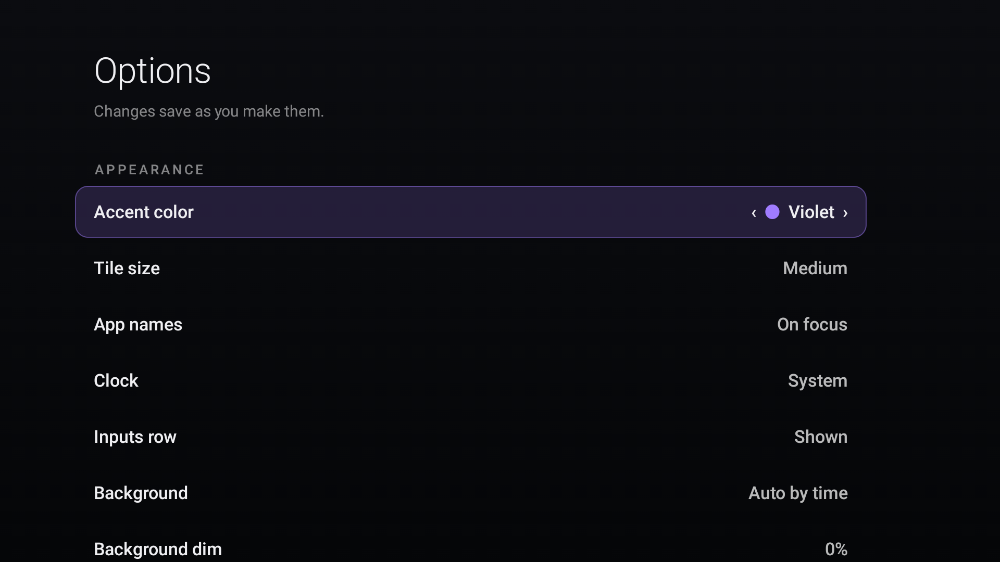
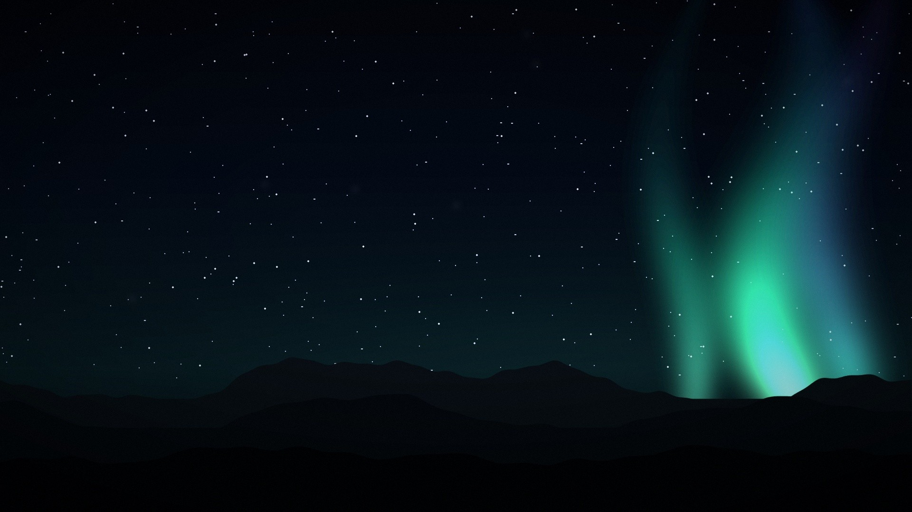
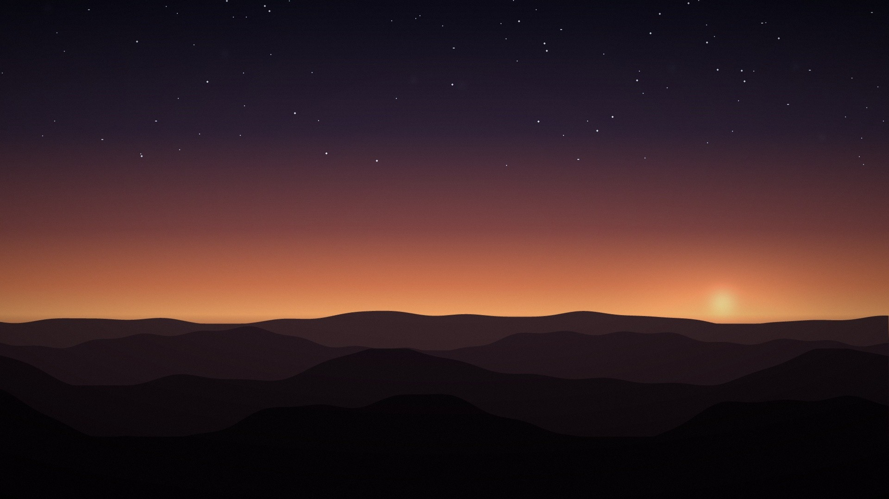
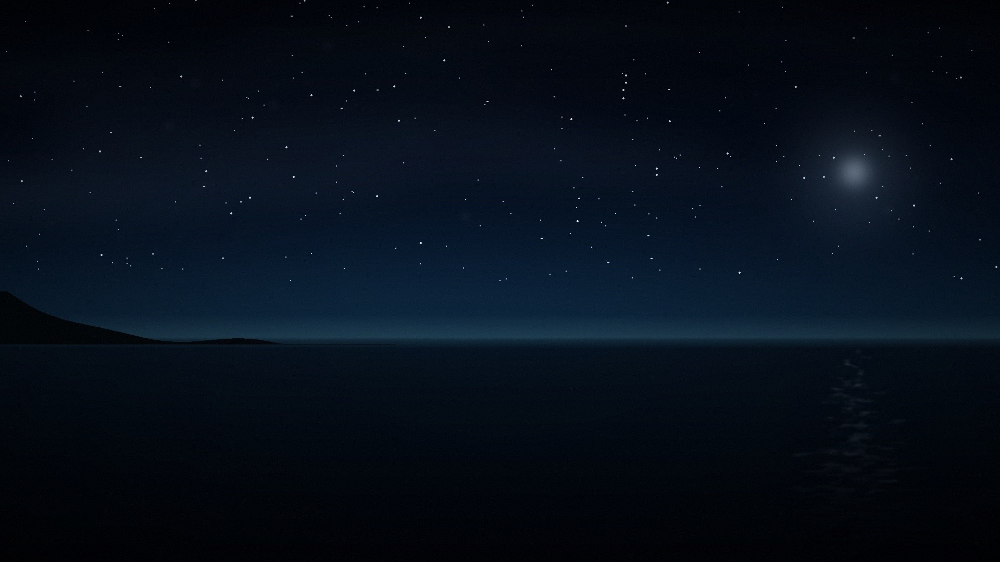

# dumbtv home — fork

**Short description for GitHub (About):**

> A fork of dumbtv home: a quieter, cinematic Fire TV launcher with three bundled
> ambient scenes and a working HOME takeover on Fire OS 8. Still offline, ad-free,
> and permission-free on Fire OS 7/8. Apps and HDMI inputs only.

This is a fork of [humblemuzzu/dumbtv](https://github.com/humblemuzzu/dumbtv),
focused on the home screen. This copy lives at
[Kyneton95/dumbtv](https://github.com/Kyneton95/dumbtv). It keeps the upstream purpose — a fast, offline
launcher for apps and HDMI inputs with no ads, tracking, accounts or network
permission — and changes how it looks and how reliably it takes HOME on newer
Fire OS.

## What is different

- **A new look.** Full-bleed ambient scenes, a layered scrim, a 64 sp light clock,
  larger 16:9 cards, a softer multi-cue focus state, and a redesigned Options
  screen.
- **Three built-in scenes.** Aurora, Dunes at dusk and Moonlit coast are packed
  into the APK (1920×1080 WebP). `Auto` follows the time of day; `Next background`
  steps through them. No download, no storage permission.
- **Fire OS 8 HOME fix.** Android 11 blocks the alarm-fired activity start the
  upstream Guard used. This fork moves the existing Home task to the front
  instead (`moveTaskToFront`), targeting the task whose base activity is
  `Home`. No new permission.
- **Cleaner artwork.** Supersampled, smoothed ridgelines and lossless source
  encoding remove the stair-stepping visible on a 4K panel.
- **Small build/install fixes.** Bundled assets are packed by `build.sh`; the
  build tolerates a missing `zip`; `install.sh` understands newer adb output.

## Screenshots




| Aurora | Dunes at dusk | Moonlit coast |
|---|---|---|
|  |  |  |

The screenshots show the real app row of the test TV; they contain no server
addresses, account details, IPs or setup tokens.

## What stays the same

- No `INTERNET` permission. The launcher cannot phone home.
- No ads, recommendations, accounts, analytics or update checks.
- On Fire OS 7/8 it requests no permissions; on Fire OS 6 the same legacy
  usage/access/boot permissions as upstream.
- No `/system` writes, no root, no factory reset.
- MIT-licensed code and original artwork generated for this fork.

## Install

The download URL points at this fork. Until `launcher-v1.3` is published here,
build and install from source:

```sh
adb connect <tv-ip>:5555
./launcher/install.sh --build
```

Build requirements: JDK 17 and an Android SDK with `platforms;android-28` and
build-tools. No Gradle.

## Tested on

- Amazon AFTKRT (Fire TV Stick 4K Max), Fire OS 8.1.8.2 (Android 11, SDK 30):
  look, scenes, HOME takeover, rapid HOME presses.
- The upstream project's Fire OS 6/7 paths are unchanged.

## Upstream, license and versioning

- Upstream: [humblemuzzu/dumbtv](https://github.com/humblemuzzu/dumbtv)
- Not affiliated with or endorsed by upstream.
- License: MIT (see [LICENSE](LICENSE)); the three scenes are original artwork
  generated for this fork.
- Version: see `launcher/version.env`; changes are in [CHANGELOG.md](CHANGELOG.md).
